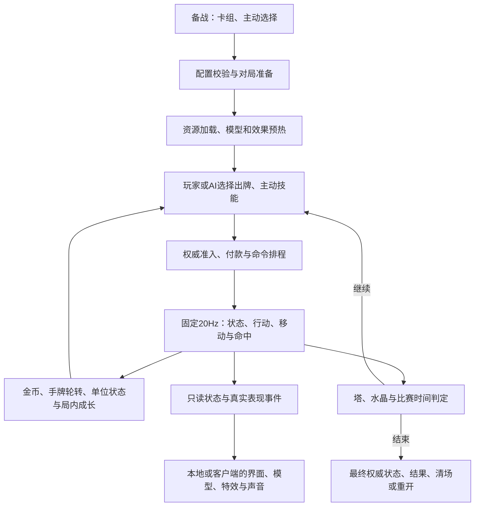
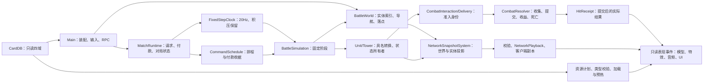

# 项目结构与维护边界

本页是游戏整体设计地图、当前职责分层与扩展入口。共同边界见 [AGENTS](../AGENTS.md)，文件定位见 [scripts 导航](../scripts/README.md)，验证方式见 [测试手册](../tests/README.md)。正文描述已落地实现；尚未实施的拆分单列在[当前实现与后续拆分](#当前实现与后续拆分)。

## 整体设计地图

游戏的核心是用有限金币、轮转手牌、部署位置和主动技能时机，在双方同时运行的战场中争取胜利。双方各自维护八张卡的配置，四张手牌和下一张预览；前两个配置槽携带选定主动能力。单位落地后自主索敌、移动和攻击，玩家通过继续部署与技能改变局势，而不逐个操纵单位。

地图包含河道、桥、两路推进空间、双方公主塔和水晶。身体、射程、部署格和路径属于二维权威战场；模型高度、镜头和窗口不改变这些规则。场地见[竞技场](units/arena.md)，部署资格见[部署规则](UNIT_DEPLOYMENT.md)，单位、建筑、法术与编队的差异见[卡牌机制](CARD_DESIGN.md)。

正常对局的战场胜负由 [MatchRules](../scripts/battle/match_rules.gd) 在完整 Tick 结算后判断：水晶被摧毁可直接结束；时间边界与加时按双方被毁公主塔数量判定优势或平局。断线由会话流程结束对局。确切时长、兵线和金币节奏查[竞技场数值](units/arena.md#数值)，实现所有者分别为 MatchRules、[MinionWaveSchedule](../scripts/battle/minion_wave_schedule.gd) 和 [ElixirManager](../scripts/battle/elixir_manager.gd)。自动兵线与玩家出牌共同影响同一战场。

## 从规则到代码

分层首先回答四个问题：谁决定世界变化、何时允许变化、状态由谁保存、观察者需要看见什么。当前边界如下：

| 设计问题 | 当前代码边界 | 扩展时保留的约束 |
| --- | --- | --- |
| 一张卡能做什么 | CardDB 的四域只读定义；部署卡的生成计划引用真实实体定义 | 配置表达已有能力；实例生命、目标、次数和计时不写回定义 |
| 一次操作何时生效 | Main 适配输入/RPC，MatchRuntime 受理、付款，CommandSchedule 管排程和收据 | 玩家、AI、RPC 共用准入和正式命令时序；输入或动画回调不能直接判伤害 |
| 世界怎样向前走 | FixedStepClock 输入经过时间，BattleSimulation 按固定阶段调用状态所有者 | 单机/服务器唯一权威；客户端只请求与接收，不推进规则时钟 |
| 玩家怎样看到结果 | 权威状态产生只读表现投影、网络快照和真实事件 | 模型、界面和声音消费结果；渲染插值和播放时钟不能反向驱动规则 |

数据依次经过“作者配置 → 已编译只读定义 → 对局配置/生成请求 → 实体和排程的实例状态 → 接收方可见投影”。这些对象不能互相充当缓存或状态副本：来源卡不等于实际生成的成员定义，主动槽不等于实体身份，浏览偏好也不等于最终出战配置。六类小兵的 `spawn_plan` 已明确区分部署卡与实体；其他同质卡仍沿用其现有定义单向投影，具体边界见[编队卡与实体定义](CARD_DESIGN.md#编队卡与实体定义)。

正式出牌入口为 `Main.play_card()`，主动入口为 `Main.use_active_skill()`；两个入口把权威请求交给MatchRuntime，客户端分支只记录请求反馈并发送RPC；普通单位生成落到 `_spawn_unit(UnitSpawnRequest)`，法术落到 `_cast_spell()`。工作台仍复用这些正式能力，但卡牌预览可显式使用 immediate 模式，主动预览通过 `preview_active_skill()` 跳过对局请求等待与资格消费；真实起手、延迟命中和控制规则继续由同一实现执行。工作台不是额外一套战斗引擎。

### 一个权威 Tick 的阶段

下表概括 [BattleSimulation.step](../scripts/battle/battle_simulation.gd) 当前顺序；精确调用与批次边界以该方法为准。

| 顺序 | 阶段 | 目的 |
| --- | --- | --- |
| 1 | 对局金币/AI、旧状态与动作时钟、待换形及主动冷却 | 先推进旧状态，本 Tick 新状态不重复扣时 |
| 2 | 旧施法命中、在途召唤、持续技能效果 | 按技能阶段分别收集、统一提交命中 |
| 3 | 卡牌部署、主动命令、法术区域、兵线 | 接受的命令在权威边界执行，不由网络到达帧提前生效 |
| 4 | 固定 combatants 名单、自然生命周期、流血及单位/塔行动 | 保持同批公平性；死亡生成者不回头加入旧行动名单 |
| 5 | 队伍增幅、预部署完成、移动与保护位置、弹体命中 | 各所有者推进自己的状态，弹体仍按阶段批结算 |
| 6 | 塔激活、障碍释放及比赛结果 | 根据本 Tick 全部结果判断终局，再供快照与表现读取 |

Runtime在状态更新后发通知，Main据此刷新技能readiness、手牌或计时；权威准入不读取CardHand或按钮pending。客户端输入pending只影响请求反馈与重复发送。自动联网样本逻辑留在Main的开发适配，由原塔收尾后的通知触发，不属于Simulation。World继续显式处理塔激活/占位与导航维护。

工作台复用这些阶段，但不运行正式对局的金币/AI、常规兵线与比赛倒计时。状态更新与表现刷新使用不同的时间：权威 Tick 决定数值与位置，渲染帧只在已知状态间插值，客户端播放轴只决定何时应用已收到的副本和事件。暂停关闭推进入口，不能通过继续积累固定时钟再补跑来模拟暂停。

## 模块职责

效果采样的状态覆盖目前仅沙盾及蚂蚱R beam两个家族；各在一次可见样本中检查固定几何/材质状态并实际绘制。沙盾模型附属入口复用声明、另有自己的必要一次绘制；其余效果维持下文保守策略。资格绑定相关源码身份，普通依赖重生成不能自动认可变化内容。声明、保守策略及拒绝边界见[效果预热覆盖契约](EFFECT_WARMUP_COVERAGE.md)。

以下是当前所有者，不要求每一行成为新目录或独立框架。Unit/Tower 通过 BattleContext 取服务；系统组合与场景、RPC 装配仍由 Main 承担。

图中箭头表示主要调用或消费方向；Main装配Runtime与World，BattleContext让实体访问同一服务。MatchRuntime持有并操作命令、资格、牌序、成长、兵线与规则，BattleSimulation只调度同一Tick的既有阶段。客户端副本由网络应用入口写入，图中的“只读”指客户端规则和表现消费者不能自行推进这些权威状态。

| 层 | 状态所有者与职责 |
| --- | --- |
| 定义 | CardDB 注册逐卡四域；CardDefinitionCompiler 合并，CardShapeValidator 前置类型检查，CardValidator 校验语义与资源；共享定义递归只读 |
| 编排 | Main 装配节点、会话生命周期、资源与UI/RPC；MatchRuntime拥有对局领域状态和固定时钟；Unit/Tower 通过 BattleContext 使用服务，不能反向探测 current_scene |
| 世界 | [BattleWorld](../scripts/battle/battle_world.gd) 独占塔集合/水晶引用、权威网络实体与客户端副本索引、网络ID分配、导航与建筑占位、连续空间/落点/体型安全收尾；combatants仍取场景组快照，不另建行动注册表 |
| 对局领域 | [MatchRuntime](../scripts/battle/match_runtime.gd) 实际持有CommandSchedule、ActiveSkillRoster、MatchRules、MinionWaveSchedule、CardPlayHistory、MatchCardGrowth、双方权威CardCycle、FixedStepClock及Tick/阶段权限；统一受理、支付、执行、取消和退款；绑定现有ElixirManager，不复制余额；不持有Main控制器 |
| 固定阶段 | BattleSimulation接收Runtime/World，编排同一权威 Tick 的状态、命令、技能、单位、移动、弹体与胜负；独立服务器、单机和工作台共用，客户端拒绝调用 |
| 比赛 | FixedStepClock 积压与 Tick；MatchRules 时间/胜负；MatchSession 双玩家身份映射/握手/独立命令序号；ElixirManager 金币；MinionWaveSchedule 兵线阶段、延迟条目与有序生成请求 |
| 卡牌命令 | CardCycle 服务端/单机完整牌序与独立随机源，ClientHandState仅保存客户端四张手牌/下一张/版本，ClientInputState持有请求反馈；CardPlayHistory 最近成功出牌/镜像代次；MatchCardGrowth 每阵营局内成长；CommandSchedule 排程（含不依附来源的在途召唤），CommandPayment 一次性付款收据 |
| 部署 | UnitSpawnRequest 具名生成参数（不改变网络载荷）；DeploymentRules 区域/建筑合法落点；PreDeploymentSweep 预部署轨迹与扫掠查询；部署命中集合随排程条目存活 |
| 通用实体 | Unit/Tower 汇合权限、委托状态并执行生命周期；普通新卡复用 Unit，不建立英雄子类 |
| 控制与攻击 | StatusInstances 来源独立窗口；ControlState 硬控/减速；AttackTimeline 前后摇、间隔、基础攻速表现时间 |
| 生命状态 | ShieldState 每层生命/时间/衰减/恢复与爆炸资格；BleedState 来源叠层/窗口/余量；AssistConversionState 受击目标的参与击杀窗口与一次性转化；DeathFormState 致死换形资格、等待 Tick 与衰血 |
| 位移 | MovementSystem 碰撞与移动；NavGrid 动态导航格、nav_lane_layout 静态路线场、BattlePathSearch 搜索；KnockbackState 普通击退；StructureRushState 建筑冲撞；TerrainTraversalState 穿地形门禁；UnitLandingQuery 连续几何落点 |
| 命中与技能 | CombatInteraction/TargetProtectionState 准入与固定圣霭；CombatResolver 阶段命中/附带效果/收益/死亡队列；ProjectileSystem 弹体；SpellSystem 法术与可选速度配置的在途时钟；ActiveSkillEffectSystem 技能效果与 DashStrikeState、OrnnChargeState |
| 周期队伍普攻增幅 | TeamAttackBoostSystem 主机固定 Tick 选择未增幅友军并写入 Unit 永久倍率；快照只复制倍率，不复制周期时钟 |
| 主动资格 | ActiveSkillLifecycle 协调准备、起手、动作和排程，CommandSchedule 按身份结束/取消；ActiveSkillRoster 技能槽、编队转交、次数、冷却、免费追斩；效果执行身份归 CommandSchedule 与 Unit.active_skill_cast_serial |
| 联网 | NetworkClock拥有RTT/时钟采样，NetworkCommandState拥有公开命令准备记录，visit仅提供只读字典，NetworkPlayback拥有客户端快照/事件播放时间轴，仅入队后重排，保持同Tick事件先于快照；NetworkEntityLifecycle 出生/销毁/快照屏障；NetworkSnapshotSystem 编解码与状态投影；RPC 保留在 Main 节点 |
| 表现 | UnitPresentationState 只读视图；PresentationConfig 形态选择；PresentationEvents 真实事件能力；UnitModel3D/TowerModel3D/BattleEffects2D 只读驱动图像；SkillEffectPresentation 拥有范围/护盾视觉实例、渲染计时与网络去重；GrowthEffect2D绘制成长气浪/叶片，GrowthMark3D以共享网格和深度测试表现持续花叶纹样 |
| 动画与资源 | MatchResourcePlan 展开卡牌/技能声明；EffectResourceManifest 解析效果文件；VisualActionSequence 片段进度；ModelVisualResources 实例动画库与材质；MatchResources 本局资源强引用；MatchModelPool 预热/领取/回收 |
| 音频 | GameAudioManager 事件消费、播放器、区域时钟、暂停与清场；default_bus_layout.tres 持有总线压缩/限幅，见[动态混音](AUDIO_INTEGRATION.md#通用混音动态处理)；不由技能系统推进音频 |
| UI 与工作台 | CardDetails/CardArt 详情与卡面；WorkbenchSession 选择和操作会话；模型预览、声音目录、牌库及窗口布局各有独立组件 |

## 改动应落在哪里

- 普通新卡：逐卡定义、注册、正式素材和单位文档。新增字段必须有读取方、schema/validator 与回归。
- 新规则：扩展对应所有者；跨客户端可见的状态同步更新协议读写。不要在 Main 增加领域系统私有数组的别名。
- 新表现：读取状态或真实事件；缺事件时补派发、消费、去重，不能从动画回调结算伤害。
- 工作台：`scripts/ui/development_workbench.gd` 负责界面，`ui/workbench/` 提供组件；玩家、AI、RPC、工作台出牌统一走 `play_card()`。
- 离线加工与复现：放 `tools/`。正式资源只进 `assets/`，候选和验证产物留本地开发素材库。

## 需要保留的语义

独立服务器/单机固定 20Hz；每帧最多赶 4 Tick，或已耗时 8 ms 后停止继续赶步，积压保留，单 Tick 不截断。客户端只请求操作、接收快照及事件，不自行解除控制、判伤害或提前换形。

Runtime持有FixedStepClock（20Hz、每帧4Tick/8ms、积压保留），Main.can_advance_simulation提供场景运行门禁供clock.running消费；工作台由 WorkbenchSession.battle_active 与面板当前页/牌库/手动暂停共同决定。暂停帧不调用 advance，避免累计暂停墙钟；节点 process_mode 只暂停子节点回调。地图输入许可独立保留，允许暂停布置场景。

同源状态刷新/替换、异源独立到期、强度聚合见[状态共通合同](status/CORE.md)；动作取消与权限见[动作合同](status/ACTIONS.md)。状态正时长向上取整到 Tick。AttackTimeline 的取消、命中与后摇写入分开，避免形态变化后写回旧阶段。

CombatResolver 按阶段收集并统一提交；单位行动阶段先固定 combatants 参与者名单，再推进建筑自然生命周期；自然退出生成的对象不回头加入本阶段名单。普通击退按出生身份、来源事件序号及子序号排序，不以遍历顺序分配身份。真实在途弹体保留出手来源和形态；来源死亡后仍可命中，但不给死者生命或技能资源收益。规则细节见[卡牌机制](CARD_DESIGN.md)、[数值](NUMERIC_SYSTEM.md)和[移动接触](BATTLE_CONTACT_MODEL.md)。

## Unit高风险写入口

Unit仍协调能力，不复制AttackTimeline、ControlState、DeathFormState、ShieldState。生产效果通过具名接口写状态，以下为允许写入点；初始化、开发预览与客户端投影明确区别于权威变化。

| 字段/事实 | 权威写入入口及所有者 | 具名例外 |
| --- | --- | --- |
| `hp` | `take_damage`；`heal`/`heal_with_overflow`与内部`_receive_health_gain`；到期盾`_restore_shield_health`；`pay_rush_health_cost`；生命周期自然衰血、`_die`、`apply_death_form_decay`、`complete_death_form_transition` | `setup`初值；`restore_replica_combat_state`直接覆盖主机值，不治疗/消费盾/发奖 |
| `max_hp`、成长与牺牲体型 | `_change_max_health`由`apply_permanent_growth`、`apply_sacrifice_empowerment`/`set_sacrifice_stats`、`_apply_form`协调；`begin_death_form_transition`清成长 | `setup`；副本只差值恢复成长/牺牲属性，形态装载只共用无生命/动作副作用的`_load_form_attributes` |
| `form_index`、`form_change_serial` | `_apply_form`，保留原换形取消与空间收尾 | `sync_network_form`只接受主机序号，不增加代次；模型池离树样本的初始化形态不是战斗实体 |
| 硬控/减速与技能状态 | `freeze`/`stun`/`apply_stasis`/`silence`/`taunt`及减速入口委托ControlState；`clear_channel_stun`只清同来源；`apply_damage_reduction`、`apply_effect_shield`/`consume_effect_shield`、`apply_death_spawn`、`apply_timed_lifesteal`、`apply_unit_phasing`、`apply_ranged_attack`委托StatusInstances | 副本走ControlState的`apply_replica_*`、DeathFormState/TargetProtectionState的`apply_replica`，不施加权威效果 |
| 攻击/施法代次和剩余时钟 | AttackTimeline、取消、`begin_active_skill_cast`/`sync_dash_cast`/`finish_dash_cast`，Ornn通过带序号`set_dash_moving`；强化/引导分别用`prepare_execute_attack`、`prepare_channeled_attack` | 网络只应用取消屏障、部署剩余时间及`net_*`表现字段；不推进权威动作 |
| 攻速增益 | `apply_attack_speed_buff`及原到期/减速入口统一`_rescale_attack_phase`，不重启归一化进度 | 副本最终倍率只写表现值 |
| 普通权威位置 | MovementSystem提交每Tick运动/击退/接触；Unit的`apply_dash_motion`提交连续技能子步 | Main出生工厂的`position`初始化；客户端`_process`只向`net_target_pos`表现插值 |
| 不连续位置与路径/插值缓存 | `teleport_to`、`leave_terrain_for_attack`、`recover_displacement_position`、World选点后调用`apply_body_resize_position`/`apply_deployment_push_position`，共同`_relocate_authority`；连续突进保留Tick起点 | 副本仅主机传送序号变化时重置位置/插值，不查询落点；不改变权威与表现坐标分工 |
| 寻路缓存 | Unit寻路/体型/取消收尾；StructureRushState提供搜索结果给`set_structure_approach_path` | 初始化空路径；网络恢复不使用权威寻路 |
| 技能资源 | Unit消费/命中/受击/击杀/衰减；部分资源施法用`grant_partial_cast_resource`，保持原增量规则 | Main工作台`_set_art_dev_skill_resource`显式设置预览值；副本资源比率只写`net_skill_resource_ratio` |
| 盾层、流血与死亡资格 | 原ShieldState/BleedState/DeathFormState仍唯一保存和消费；`end_life_for_summon`/`finish_sacrifice_leap`保留原死亡顺序 | 副本只恢复可见投影和等待事实，不产生死亡奖励或新的复生资格 |

HitReceipt仍是字典：`accepted`表示受理/排队，`settled`表示最终提交；提交前`landed=false`，提交后才表示真实命中。`health_lost`与`shield_absorbed`为实际结果，同批过量伤害按原比例分配；名义`damage`不作为吸血量。零伤害合法受理保留原命中规则，但不分走其他来源的击杀收益。效果盾的收集期预留及Delivery独立身份、结构死亡事实幂等账本均保留。

BattleNumbers构造/结算回执；CombatResolver统一提交和发放真实击杀收益，`resolve_attack_hit`即时调用也走正式小批次，统一返回含`hits`的总回执，不再保留旧即时别名或双义bool；子命中提交后、效果/收益之前汇合总回执。纯离树对象可直接调用BattleNumbers，复用相同回执核心，不另发奖；奥恩冲撞必须有真实BattleContext，缺失直接断言失败。普攻/范围吸血、命中资源/成长/结构助攻、流血处决、突进回血/冲撞生成均读取提交结果；格温首次命中回血也在提交后且每次施法只发一次。流余量和弹体命中集合可按受理预留，它们不是收益；技能箭控制与命中声读取提交后的回执。ChanneledAttackState必须收到prepare_cast建立的Delivery，不再在begin补造身份；Unit/Tower控制合同明确校验，已知调用方全部迁移。同步表现监听者释放实体时，Resolver的延后收益以弱引用查询存活对象；失效Callable和死亡节点安全跳过。

## 严格契约与正常边界

当前接口只服务本项目当前生产与测试消费者；迁移时一起修改调用方，不维护旧Main代理、字段别名、旧RPC签名或快照双入口。缺必需事实要反馈原因并停止相应操作，不能补造事实后报告成功。细节由以下所有者维护：

| 输入或错误 | 当前处理 | 合法边界 |
| --- | --- | --- |
| 配置形状与资源声明 | CardValidator先完成整表形状预检，再读跨引用；声明路径缺失/类型错误进入启动失败 | 定义允许空卡面、空声音或省略技能图标；声明路径后必须有效 |
| 内部快照/出生事实与塔拓扑 | 当前六塔、14字段出生描述及必需弹体字段缺失进入ContractFailure；可靠出生工厂失败向停止路径传播 | 陈旧生命周期消息、已存在实体是幂等边界；远端坏包完整拒绝，不写入部分状态 |
| 权威落点 | 无解查询返回Vector2.INF；普通生成拒绝，体型安全交接失败停止本局 | 付费部署按既有排程等待合法位置；不改为免费成功或新增退款 |
| 生命周期与收益 | 来源/目标释放使用弱引用和幂等清理；当前批次收尾后停止后续失败阶段 | 已提交伤害不撤销，失效来源不领取收益，独立区域按自身寿命继续 |
| 资源能力与缓存 | 模型扩展能力、合法可选视觉参数及来源刷新桶按定义处理；生成依赖失效由开发/构建门禁拒绝 | 属于当前有效数据/缓存路径，不代表支持旧协议或吞掉原数据加载失败 |

先知引导期间召唤计时和到期释放照常；控制仍沿用已有待发与已开门序列合同，见[下一击引导](status/ACTIONS.md#下一击引导)。不能把引导的行动锁误作周期产出门禁。测试监督和失败清理也属于必须保留的安全边界，不承诺“绝对不存在任何默认值或fallback”。

## 比赛与网络生命周期

MatchSession 在服务器绑定两名玩家，独立保存玩家身份、阵营、连接和请求序号；两端校验协议版本、内容指纹和合法卡组，再分别加载并确认就绪。服务器无本地玩家，不实例化界面、模型池及音频管理器。加载不推进战斗；准备和等待共享 30 秒超时，局中不能重注册卡组。请求按会话/连接映射阵营/各玩家单调序号校验，所有表现事件携带会话身份。

NetworkEntityLifecycle 按生命周期序号区分同 Tick 生成与销毁；快照能恢复未知实体，旧会话不能污染新局。ProjectileSystem 独占客户端弹体目标与插值位置；外部表现通过visible_view共享无权威对象别名、嵌套只读的表现投影，权威/测试snapshot入口仍返回隔离副本。投影按内容代次失效：Main先取天使表现，再模拟/网络应用与逐渲染帧插值，随后其他process/draw读取，因此同帧更新前后允许分别构建，不能按Engine帧号盲缓存。BattleWorld持有网络实体索引；NetworkSnapshotSystem直接读取World隔离快照，Main仅在网络生命周期适配中请求增删并收尾技能/表现。

NetworkSnapshotSystem.decode_validated 只解压与完整静态校验，不写状态；返回递归只读的 DecodedSnapshot，生产接收端直接入 NetworkPlayback，播放时 apply_decoded 重新检查会话、客户端模式、终态、Tick/生命周期序号与权威时钟。旧 packet_tick/apply(bytes) 入口已删除，所有调用方显式解码后应用同一结果。单包、队列与累计原始字节的精确预算见[联网契约](reference/NETWORK_PROTOCOL.md)，字节预算不等于 Variant 堆内存上限。出队返回数组释放或 clear 后不保留快照缓存。

发送时先确认接收者；无接收者不采集世界，有接收者只采集一次只读公共帧，各端单独编码金币与成长。终局在清场前采集一次，供本地记录及双方投影。本地解码和公共帧复用不改变线格式，不引入增量快照；当前协议值只在[联网契约](reference/NETWORK_PROTOCOL.md)维护。

终局可靠信封包含最终快照；客户端先应用状态再显示结果，重复终态幂等，普通快照不能恢复战斗。终局清命令、弹体、区域及常规战斗音频，水晶爆炸独占音轨自然结束后触发本地结果播报；客户端返回菜单释放本场 ENet；正常终局两端离开或断线失败后服务器重建干净会话。规则或载荷变更须提升协议版本，精确契约唯一入口为[网络协议](reference/NETWORK_PROTOCOL.md)。不支持局内断线续接。

配置校验失败、资源准备失败及服务端端口绑定失败统一进入启动失败入口，显示具体原因并取消准备、清理命令与表现；不创建胜负、比分或终局快照。加载期间收到网络中止同样处理；运行期断线与正常终局仍沿用比赛终态。重复失败不重复显示面板或恢复战斗。

## 状态与排程所有权

CommandSchedule 通过 enqueue/take/cancel/clear 管理内部集合；inspect 仅用于低频检查，生产 Tick 不复制全量集合。付款收据绑定原付款者：开始施放消费、存活取消退款、死亡/会话清场关闭。等待部署不预留建筑占地；真正生成时选择最近合法位置，全场无位置则保留到下一 Tick。凝滞等不可推动占位的玩家部署复用这一策略，编队先整体规划；可推动单位含冰冻继续自然碰撞。召唤/复生使用全场几何，不套用玩家部署范围。

MatchCardGrowth.apply_snapshot 比较完整UI可见状态；只有变化才复制副本并通知手牌刷新，进度尚未解锁同样算变化。金币、选择、待执行和牌序继续走各自刷新入口。ActiveSkillRoster.cost 是纯数值查询，与prepare_use共用次数索引和费用规则；完整施法仍创建独立技能配置，不缓存派生费用。

ActiveSkillRoster.entry 是单项只读视图，权威消费走 consume，客户端走 replace_replica。多单位卡的来源卡、部署身份与技能槽分别保存；转交只查询同次部署的存活成员，不能以卡 ID 相同推断资格。CardCycle仅在权威端维护完整牌序与版本；可靠确认只下发本方四张手牌与下一张，ClientHandState按版本及请求序号更新，客户端不洗牌、不推导隐藏队列。

盾层自然到期由 ShieldState 返回一次性结果；死亡和清除不能触发恢复或爆炸。盾层和StatusInstances减伤自然到期的爆炸统一通过queue_expiry_explosion递交技能效果批次；流血由 Unit/Tower 各自持有，CombatResolver 发放存活来源收益。形态、生命上限、待变形代次和技能资源由 Unit 汇合，死亡替身/复生的新实体不能与原位换形混用。

技能后段绑定施法身份；冰冻/死亡取消依附动作，龙王星辰等独立结果持有固定落点和归因。DashStrikeState 在 skill_effects 阶段推进可受伤的穿单位突进，OrnnChargeState 按固定速度采样地形/建筑并结算沿途命中与停点范围效果，MovementSystem 跳过这两种状态的普通推挤。状态对象不直接写 Unit 的位置、锁、寻路或形态字段；Unit 的位置转换、突进完成和致死换形接口统一应用，旧施法序号不能释放新施法。PreDeploymentSweep 只在权威端得到伤害目标；客户端采样轨迹只用于显示。

### 请求与界面的依赖方向

ClientInputState 保存本方已发未确认的请求，NetworkCommandState 在受理通知后接手公开排程，CommandSchedule 持有权威待执行与付款收据。主动技能提交资格只查询这三个真实所有者，不建立第四份等待状态，不读取 ActiveSkillBar 的 pending 判断规则。完成、拒绝、死亡、替换、终局和重开先清理对应状态，再投影 UI；旧请求编号不能清除新请求，编队资格转交不能误删新持有者状态。

UI 重建后从真实所有者恢复等待状态；只在视图变化时设置 pending，保留已有倒数标签。界面比较只用于幂等绘制，不参与资格或扣费。

六类小兵编队的卡牌/实体边界见[卡牌数据](CARD_DESIGN.md#编队卡与实体定义)。模型池按生成计划的重复成员引用计算库存，补足旧成员列表漏计；这会增加相关卡组准备库存，属于保持预热质量的修正，不是局中性能收益。

### 公共战斗事实

Unit持有唯一 `combat_idle_seconds`，旧状态推进前采样持续战斗条件。成功伤害及控制/减益入口通过CombatInteraction记录双方事实，CombatResolver保留批次来源；StealthState只消费同一空闲时长，不独立推进生产计时。瑟提资源衰减使用相同时长与自身阈值。主动位移控制取消沿用动作序号/累计取消屏障，不改变同批伤害或独立结果合同。奥恩被动系统不接入公共脱战门禁。

## 资源准备与表现复用

加载页至少保持 1 秒且等待实际准备完成。MatchResourcePlan 在双方卡组与技能选择确定后，按阵营计算可达卡牌、召唤物、形态和技能；MatchResources 只收集该计划内的资源及四类兵线、地图、塔、水晶与声音；正式加载入口以最多 128 个未完成请求组成的引擎任务队列后台读取尚未缓存的资源，主线程先接收完成请求，再同帧补满队列，保留强引用并检查类型，不能提前调用阻塞等待。已知卡牌重复请求直接复用本局集合，不重新解析整局粒子JSON。取消后不新增请求，收尾已有请求；加载场景销毁时将已发请求移交短命节点领取完成结果并自行退出；资源缺失或加载失败停止准备。命令行单机同样经过加载页；工作台和内部测试保留全卡同步入口，正式加载时 UI 不提前同步加载整副卡组。CardDB 启动校验路径和配置，开发验证继续执行完整资源/音频类型/特效检查。

MatchModelDemand 将真实牌组、镜像副本和系统兵线来源分开，按重复部署成员、被动/主动/亡语/转换/复活及死亡替身建立账单，再按共享模型路径相加；同一来源互斥形态的同path取最大，独立来源相加。镜像不扩大自动兵线，普通席镜像不携带主动。首轮事件预算与旧有限储备政策独立，不再将两代、两批及全部主动次数叠乘，详情见[模型库存契约](MODEL_POOL_DEMAND.md)。MatchModelPool 在遮罩后预建模型和实例独立动画库。离树只读样本不参与战斗或发声；Compatibility 渲染器实际绘制不同网格/材质组合，隐藏保留样本与绘制资源。预热遍历动画起点及可达的受击/冻结/强化材质组合；没有冰冻时跳过冻结采样。效果提供者声明全场 `stasis` 目标状态时才加载金身贴图、创建并绘制金身材质；防御塔同样在遮罩内绘制并恢复，免疫水晶不参与，有隐身能力的模型另绘制透明隐身材质。预部署场景调用真实纯表现 setup/advance 接口，分段采样入场过程；相同需求合并，互斥形态容量不覆盖预热配置。模型实例/动画采样在加载遮罩内按约 32ms 批次让出主线程（单个实例或驱动绘制不能截断），取消时立即隐藏预热样本；模型池容量不因此扩张。

ModelVisualResources 对未压缩的纯数值骨骼/混合形状动画使用 copy_track 构建实例独立副本；资源值、事件、压缩轨道或脚本/元数据扩展仍完整深复制，同库别名保留。无脚本模型只复制配置引用的动作（递归包含键和值、所有形态并集）及 RESET；脚本包装和扩展动画库保守保留完整片段。动画复制可分步完成，半成品不参与战斗，源库保持不变。MatchModelPool 仅在资源所有者明确将强化后三态构造为基础前三态的引用别名（没有任何强化材质）时，省去后三次重复绘制；不以材质ID推断参数相同。可达材质状态及附属强化效果推进后的首次绘制保留；有强化材质时保留其独立绘制。场景树、动画副本与实际绘制仍在主线程，后台线程只读取资源；资源闭包、实例预算和双方 ready 门槛保持原流程。 headless/Dummy后端采用主线程每16路径分批读取同一完整资源集合并响应取消，隔离后台纹理反序列化与主线程创建RID交错的潜在竞争风险（最小样例未复现，根因尚未确定，见本次改动记录）；保留全部资源强引用、模型池及效果预热。其主线程读取计入resources/preparation_usec，threaded_requests/wait为0；真实可渲染模式仍采用128任务窗口异步加载，不据headless耗时推断GUI加载收益。本局闭包包含冰冻法术时，加载遮罩下预建并实际绘制一个冰面槽，随后隐藏；不创建法术状态、伤害或声音，开战后复用该槽。腐蚀的粒子纹理由依赖清单纳入本局资源集合；加载时用独立表现字典分帧采样 0–4.75 秒，覆盖延迟出生层并保留隐藏样本，不写入正式法术集合。除已声明状态覆盖的沙盾/beam采样入口外，SpellEffectWarmup 仍逐个执行原采样年龄并创建/保留粒子池；同一可见网格、表面、ShaderMaterial 与 Shader 的 RID 组合已实际提交后，不为纯参数变化重复等一帧。新粒子独立材质、新网格与迟出生层继续绘制；只对当前播放器不原地改写的静态ArrayMesh进行此复用；ImmediateMesh、未迁移PrimitiveMesh、脚本网格、2D、标准/未知材质、叠加及多遍材质保留完整采样绘制。实际提交使用自然帧 frame_post_draw，避免额外 force_draw 后再次自然绘制；headless 继续逐帧让出且不冒充绘制。新增预热不等于所有事件/动态材质组合已经穷尽；按首次事件测量继续补充。

模型池只回收已审计模型/显式支持 reset_pool_visual 的包装，重置骨骼、网格、变换、动画循环区间及材质。初始库存、保留容量和分步补货能力独立；对未证明更紧需求的路径保留明确的旧2/32/64有限缓存政策，first_burst不被截断；开发期以声明/深度/访问/数量预算拒绝未审阅的巨大计划，不用脚本存在或一次实例化耗时改写数量。每个模型包装根声明version1的loading-only或step-bind构造契约，未知/缺失拒绝；step-bind逐项核对实际脚本目录。无明确能力的包装完整准备有限储备，当前奥恩及经构造审阅的女皇、赛恩、两纳尔、两鱼共七个脚本路径显式许可分步构造，模板存在本身不授予资格。局中补回min(初始,容量)闲置库存，容量仅约束闲置缓存，活体由消费者持有，因此活体加闲置可超过容量。补货根据process_frame起点至调用的已发生工作有限退让，不用帧间隔判断忙碌；每帧最多一个构造/入树、包装、begin_bind或单clip步骤，任务间轮转路径。前台工作≥8ms最多退让3帧，单步超1ms后冷却1～3帧，持续超载仍有限恢复。单个引擎操作不可抢占，1ms是目标；超时如实计数，不据单次波动关闭能力或重算库存。半成品完成后入池；取消清owner/节点并断开帧信号，release清观察器。时钟不覆盖起点前物理、调用后节点或GPU，不保证任意生产吞吐或整帧预算。计划内耗尽仍同步创建完整表现并记录最长创建步骤，容量不是活体上限，不丢合法单位；附属buff由每模型已准备bank持有、预部署由独立消费者持有，这些场景保留绘制样本而不另造无人领取的库存。UnitModel3D代理、信号与动态特效不复用。

金克丝/飞机的投影三角面保持原面数、UV、顺序、混合及绘制接口；固定Packed顶点/UV/白色数组由效果依赖准备期构建，飞机0.20/0.25两比例分别缓存以保持原计算结果。局中复用不再逐面创建数组；仍有原draw_polygon脚本调用，不把它等同于GPU drawcall优化。虚空兽trail的出生时间索引归现有按kind共享采样缓存且只读，世界birth_positions仍每实例独立；停止发射、回退与出生起算的寿命不变。

EffectResourceManifest 只读取按 provider/variant 生成的版本化依赖清单，不在开局发现依赖、读取大源件计算 SHA 或回退完整 JSON。层/系统筛选与 Shader 选择在开发生成时调用同一提供者策略；源/策略内容身份和产物精确 SHA 由编辑器运行前、开发验证和正式导出门禁检查。旧22份依赖头已被统一产物替代；播放器仍使用的采样/网格 JSON 保留运行依赖。格式、失效与新卡操作见[资源生成流程](RESOURCE_ARTIFACTS.md)。

UnitModel3D现行控制姿势由_was_controlled与实际权威状态消费；无入口的旧_saved_control/stun_enter-loop-exit恢复链已移除。冻结刷新、换形冻结、死亡覆盖、解冻仍晕及旧serial/generation拒绝均由实际控制/动作合同保持，不依赖存回旧动画片段。

### 单场数据和确定性包装复用

虚空召唤的可编辑 sampled.json 位于受版本控制的 tools/source_assets/void_summoning/，不进入 PCK。运行读取 CLPS0002/schema2 紧凑产物，源 SHA 与完整位等价验证在开发生成/构建执行；载荷 SHA、长度、维度、分配上限、偏移与数组边界仍在运行检查。当前发布链没有等价的包级运行完整性保证，因此没有删除载荷 SHA。仅这一效果已迁移紧凑运行数据；其他播放器仍读其正式 JSON。详见[资源生成流程](RESOURCE_ARTIFACTS.md)。

剑魔/太阳圆盘、整表面过滤家族及VoidGate/Yorick/Kayle/Gnar的确定性加工已移入resources开发生成，包装场景引用只读模板；ModelAnimationInstance在模型根持有一次活体动画所有权，摄影、池创建、样本和分步绑定移交同一记录。模板不作活体，Animation/库、骨骼/播放器/修饰器/可变材质仍实例独立；未知所有权或已归属库被替换明确失败。未迁移脚本仍标记legacy保守策略；Pantheon严格渲染差异未解，保留原加工。通用材质按本局可达闭包严格预建；库存按独立来源账单及显式构造契约准备，仍可能耗尽；操作见[资源生成流程](RESOURCE_ARTIFACTS.md#模型模板与一次实例所有权)。CardArt在本场双方卡组确定后删除未选卡面浏览缓存的所有权，按钮自身资源引用仍正常。资源追踪和类型计数仅在性能工具输出，不在工作台加入验收持久化。

### 同模型原位换形

包装同时提供 can_reuse_visual(scene_path) 与 set_visual_form(form_index) 且接受目标场景时，保留模型、骨骼、AnimationPlayer 和实例资源，只重置动作调度、更新映射并从原姿势混合。首次装配记录根高度，避免攻击补高污染换形基准；其他单位仍走换模型路径。

## 扩展接口

WorkbenchSession 只注入放置、选中、清场、重建、暂停及视图更新端口；Main 保留节点生命周期与正式操作入口。模型/声音页只读正式配置，候选使用通用离线展台。工作台不承担验收持久化或报告导出。

治疗、控制、护盾与位移分别走准入入口；新选取和已释放命中分别判断，纯控制不能依赖实际扣血。强制位移复用唯一外力状态、稳定提交顺序与通用落点查询；途中无碰撞仅由其状态开启，不放开普通击退。未支持的禁锢等不得因相邻机制存在而声称完成，见[实现现状](status/IMPLEMENTATION.md)。

## 维护与已知限制

自动测试按 contracts/combat/deployment/status/presentation/ui/network/cards 分类；目录内测试由唯一注册表编排，共享夹具不注册。全卡内容检查、共通机制与逐卡差异各有覆盖所有者，具体约定见[测试手册](../tests/README.md)。

### 当前实现与后续拆分

当前MatchRuntime持有并操作对局状态、请求受理与经济，BattleSimulation只访问Runtime/World并保持各独立结算批次；CommandSchedule/CommandPayment 管排程与一次付款，ActiveSkillRoster 管技能资格，CardCycle/ClientHandState 分开权威牌序与客户端可见手牌。主动请求已与按钮状态分离；六类小兵使用生成计划；表现与网络已减少重复投影、采集和解码；费用和成长刷新只做必要工作。以上是已实施边界，具体实现见本页对应章节，测量结果只在实际交付与性能证据中报告。

Main、Unit、UnitModel3D 仍较大。Main承担会话、RPC、资源/节点装配与表现适配；MatchRuntime承担命令协调、部署资格/生成计划和规则推进；BattleContext的空间/落点/导航直接访问BattleWorld，其余能力继续使用原服务适配，权威实体仍是Godot节点。当前未形成独立于场景树的纯模拟内核，也没有把每项职责物理拆成独立包。

Unit属性派生、一次性生命补偿和状态写入已通过具名接口区分，见[Unit高风险写入口](#unit高风险写入口)；不再把这一边界列为未完成。后续候选仅包括其他内容家族的来源卡/生成定义关系，以及有实际需求时进一步物理拆分Unit；本轮不继续拆文件。移动空间索引、更多粒子重构或额外缓存也须先有场景测量；不因文件变长就引入 ECS、逐英雄子类、通用技能 DSL 或没有职责的转发层。

World是实际数据所有者，不把查询回绕Main。Main的迁移期索引/nav读取口、空间/部署查询代理、会话/角色/终局/钱包字段别名已删除；生产、工具和测试直接使用World、Runtime及DeploymentRules的当前接口。World的集合查询仍返回隔离只读容器，实体自身由权威逻辑修改。性能计数在派生World拦截，本地基准显式登记实体身份与出生描述，不要求生产快照补造。节点仍直接挂Main；来源ID继续由CombatResolver在child_entered_tree时分配，World不按HP猜测删除等待复生者。Runtime/Simulation及Unit高风险写入口与HitReceipt已收口。

设备、性能和联网未验证范围见[开发状态](DEV_PLAN.md)。历次记录见[归档](archive/README.md)，日常任务从[任务导航](AGENT_WORKFLOW.md)进入当前专题。

## 法术加载与绘制准备

SpellEffectWarmup在同一预热对象内以资源实例ID集合去重持有操作，Array保持首次出现顺序与强引用；不按路径合并不同实例。保守策略的每个采样年龄仍递归节点并执行原有可见资源扫描，已见可变Mesh也不能跳过后续子节点、surface或材质发现。表现退出时同时释放身份集合与保留Array；这项去重不改变采样次数、层覆盖或绘制策略。

卡牌及技能的 `resource_dependencies` 声明额外效果，EffectResourceManifest 向对应提供者解析文件清单，MatchResources 收集图标/音频与效果内部纹理、Shader，并登记原生JSON/网格文件；SpellEffectWarmup仅执行提供者的采样配方，不再维护英雄名单、技能索引、DATA或SAMPLED中央表。腐蚀沿用自己的dependency_paths与prepare_visual，冰冻沿用现有绘制准备。电击、大型电击、凝滞、爆破酒桶在加载遮罩内通过SpellEffectWarmup创建独立样本，覆盖飞行、拖尾、预警、抵达和真实命中层；实际提交绘制后保留网格/材质引用并清理样本节点。它们不进入SpellSystem权威数组，不发布卡牌事件或音频，取消加载后不再继续准备。无对应法术的卡组不预热该法术。 原版冰鸟普攻/风暴、赛恩施法/护盾/爆炸、龙王普攻吐息、天使光剑/焰浪、格温圣霭和小炮弹体/急速射击也走同一依赖收集与实际采样绘制；延迟出生层补首个可见采样。播放器明确关闭的层不再加载其独占纹理/网格。

双方各前两个槽位只带入已选的一个主动技能；双方同卡不同选择取并集。只有主动槽中的镜像允许复制本方其他卡牌的已选技能（未记录选择时与战斗一致默认为第一个），普通槽镜像不扩展主动资源，也不扩展敌方技能。成长、升级和编队继承资格，独立召唤物不会凭空获得主动。金克丝与剑魔的主动专属形态按资格收集，纳尔变形、赛恩复活等被动仍保留。格温圣霭、赛恩W、烈阳护盾及小炮Q按对应技能过滤；冰鸟和小炮普攻、龙王吐息、天使焰浪始终随可达卡牌收集；冰冻的普通冰面与强化减速场分别准备。

模型通用材质准备同样读取可达计划：同路径所有形态/阵营合并隐身能力，冻结按本局目标状态覆盖召唤/复制/复活闭包，初建、补货和后备一致。无能力的ghost和不可达freeze候选不创建，合法stasis/gold与buff私有链在加载阶段准备；正式对局未声明状态或路径明确失败，只有工作台显式tool模式允许懒准备。已准备候选在挂接、状态切换、回收时复用，原材质快照保留；库存miss与动态效果分配仍另计。确定性整表面过滤与静态纹理替换由开发模板完成，运行只读选择，动态材质参数/骨骼/部署状态仍每实例独立；当前迁移边界见[资源生成流程](RESOURCE_ARTIFACTS.md#模型模板与一次实例所有权)。

模型池和正式附属特效挂接共同使用该计划；小兵系统波次不自动预热男爵之力，金克丝与诺手的被动附属效果不被误删。梦魇只准备已选P或W层。事件音频复用 PresentationEvents 能力表过滤。金克丝/飞机弹体贴图改为按实际依赖加载，避免通用弹体脚本载入未登场卡牌的贴图。凝滞法术基础效果声明金身目标状态，普通槽凝滞同样需要金身；未携带凝滞时模型和防御塔不创建金身材质或读取贴图。共享的模型/动画库、脚本、图集和复合JSON按文件加载，不拆分其中的数据；开发工作台可任意换卡换技能，保留不受固定对局计划限制的全量模式。

原生sampled/systems/mesh JSON是运行依赖，必须在export_presets.cfg的include_filter覆盖；仅Godot资源导入成功不证明导出包包含FileAccess读取的JSON。验证使用SpellWarmupSuite、实际绘制预热和导出PCK读取检查。预热覆盖不等于已证明所有硬件上没有首帧停顿，性能结论需单独测量。

资源扩展遵循[卡牌资源依赖契约](CARD_DESIGN.md#表现资源依赖契约)和[新卡资源步骤](NEW_CARD_CHECKLIST.md#赛前资源声明)。`fields` 把主动专属形态与附属效果归属到技能；镜像以复制能力声明扩展本方技能，中央规划器不按英雄 ID 判断。潘森、蛮王等包装中的动态原生粒子、图奇隐身和余震爆炸也通过效果契约登记；潘森依赖与运行层开关共用。未使用的酒桶节点不读取原生JSON，公共余震/凝滞脚本不提前加载专属纹理或拖尾Shader。`MatchResources.raw_files` 记录原始文件，`resources` 保留加载后的引擎资源强引用；场景/图集/动画库以完整文件为边界，不能承诺文件内部未选片段不驻留。

## 窗口与战场显示

默认设计画布为 720×1280（9:16），canvas_items + expand 保持等比并随窗口扩展画布。首次打开按当前屏幕可用区域缩小窗口，F11 切换全屏。`scripts/ui/battle_layout.gd` 统一计算战场画布变换和 HUD 位置。最后可部署格子的外边缘为y=0/1280，各向后延伸一格（40世界单位），得到标准9:16纵向取景y=-40～1320；下边精确对齐手牌上边线，手牌单独保留120设计高度。基准世界缩放为1160/1360，满宽世界范围由720/此缩放计算，左右各约1.551724格，不硬编码舍入边界。整体尺寸只乘一次等比倍率；比9:16宽则增加左右取景，比9:16窄长则保持宽度、上下对称增加距离。技能保留58高图标，利用最后一排两侧不可部署角区，规则文字和成长提示在下方一格布景带，逐格验证不遮合法部署区。异常比例限制离屏纹理范围，余下为背景，不承诺任意比例均达到最佳布局。外围当前沿用现有场景和干净背景，未新增布景。

权威 Node2D、格子、塔位与服务器不缩放；输入使用同一 canvas_transform 的逆变换，外围坐标仍被部署边界拒绝。红方用同一变换翻转，HUD 位于独立 CanvasLayer。3D 继续保留 720×1280 的禁用渲染投影视口，供现有模型和效果计算；绘制相机共享原有场景，按可见世界矩形扩展正交取景并调整纹理原点。这样扩展窗口不改变模型位置或高度标记，不需要逐卡修改投影。渲染密度仍按世界像素设置，本次未增加 Retina/画质档位。

工作台临时接管窗口为原有横屏 keep 布局，退出恢复尺寸、比例策略和画布变换；对战 resize 回调在工作台期间不参与。备战卡池滚动区吸收剩余高度，结算界面按屏幕居中。

主菜单背景位于独立CanvasLayer内的全屏TextureRect，保留`arena_rift_v4.png`（720×1400），使用KEEP_ASPECT_COVERED居中等比覆盖；背景不随战场画布缩放或翻转，长屏裁两侧、9:16裁上下，持续resize自动跟随。前景独立居中单列，服务器IP与连接按钮分行，必要时滚动，背景不拦截输入。

Mac启动窗口按DisplayServer的Retina像素API读取可用桌面和实际标题栏，仅留4逻辑点必要边距，不限制最大高度。Cocoa对半逻辑点宽度取整，因此先按整逻辑点的9:16单位向下取整，再转换为像素。当前2×屏幕可用1470×844逻辑点、标题栏32点，默认客户区450×800逻辑点（900×1600像素），含标题栏外框450×832逻辑点，上下各余6点。首次Main._ready在创建主菜单前应用，场景切换不重置用户调整，不改系统显示设置。
